# ⌚ Nervos CKB Wear OS Visualisers (Pixel Watch 3)

[](https://wearos.google.com/)
[-brightgreen?style=for-the-badge&logo=github)](https://github.com/toastmanAu/ckb-watch-visualiser/releases/tag/v1.0.0)
[](https://www.nervos.org/)
[](https://threejs.org/)
[](https://developer.android.com/training/wearables/compose)

An interactive, high-performance **Wear OS (Pixel Watch 3)** housing and launcher for live **Nervos Network (CKB)** blockchain visualizers.

> 📥 **Download Release v1.0.0**: Grab [`ckb-watch-visualiser-v1.0.0.apk`](https://github.com/toastmanAu/ckb-watch-visualiser/releases/download/v1.0.0/ckb-watch-visualiser-v1.0.0.apk) for direct watch installation or [`ckb-watch-visualiser-v1.0.0.aab`](https://github.com/toastmanAu/ckb-watch-visualiser/releases/download/v1.0.0/ckb-watch-visualiser-v1.0.0.aab) for Google Play Console.

This project bridges live on-chain UTXO state transitions into tactile, scientific, and contemplative exhibits on your wrist, complete with physical digital crown navigation, haptic engine feedback, and standalone Three.js mobile-first web exhibits.

---

## 📸 Visual Showcase

### 1. Flagship: CKB Cell Laboratory
Microscopic biological UTXO organisms materialize from real on-chain data and swirl into a central glass beaker containing the glowing **"Liquid of Knowledge"**.

| Watch Menu | Observation Mode | Specimen Inspection Card |
| :---: | :---: | :---: |
|  |  |  |

### 2. Exhibition: Japanese Maple Bonsai
Newly created CKB Cells detach as vibrant autumn maple leaves that gracefully flutter, tumble, and drift from a lush **Japanese Maple Bonsai** canopy onto an ornate display stand.

| Launcher Selection | Japanese Maple Bonsai | Falling Autumn Leaves |
| :---: | :---: | :---: |
|  |  |  |

### 3. Exhibition: CKB Mechanical Cuckoo Clock
A handcrafted 3D Black Forest Chalet Cuckoo Clock keeping real-time local device time with a continuously swinging brass pendulum and dual pine-cone weights. Whenever a new canonical CKB block arrives, the internal brass gears engage, the hinged wooden doors swing open, the cuckoo bird emerges on its rail to perform a two-note pipe call, and the lower brass plaque illuminates with the block height, transaction count (including cellbase), and RFC-0027 decoded Epoch progress.

| Idle Local-Time Clock | Cuckoo Bird Block Arrival | Block & Decoded Epoch Inspector |
| :---: | :---: | :---: |
| 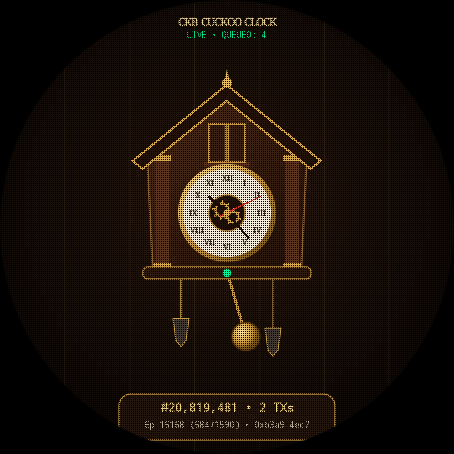 | 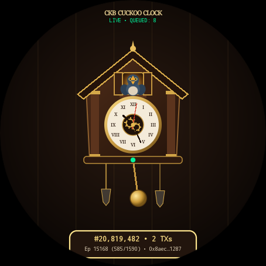 | 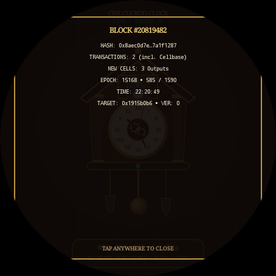 |

### 4. Exhibition: CKB Epoch Brick Tower
Reconstructs the active Nervos CKB Epoch as a 3D architectural tower of interlocking LEGO-style plastic bricks (`epochIndex + 1` out of `epochLength`). Every newly mined canonical block materializes front-and-center as a golden Hero Brick with `#BLOCK_NUMBER` printed on its face, then flies along a curved Bézier trajectory to snap and lock onto its deterministic slot at the top of the tower.

| Live Epoch Tower | Hero Brick Entrance | Epoch Progress Inspector |
| :---: | :---: | :---: |
| 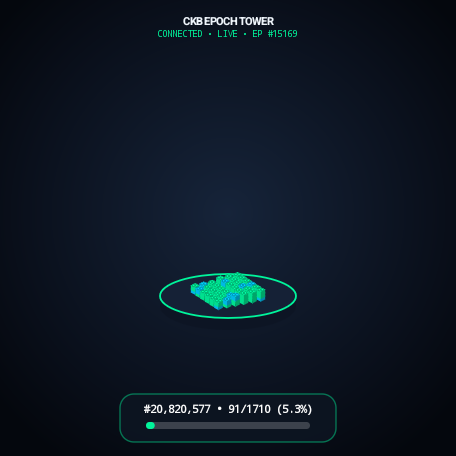 | 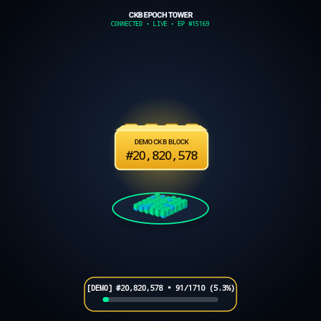 | 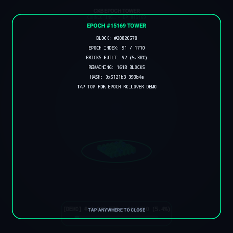 |

### 5. Exhibition: CKB Shark Raft (`ToastmanAnim.glb`)
Visualizes live Nervos CKB transactions in each newly mined block as **3D sharks circling a buoyant wooden log raft in the open ocean** (`1 Shark = 1 Transaction`, including the cellbase transaction). Both the standalone Three.js exhibit (`sharks.html`) and the native Wear OS engine (`SharkRaftVisualiserView.kt`) load and animate the supplied `ToastmanAnim.glb` 3D character and its 664-frame `Action` skeletal animation clip directly on top of the pitching wooden raft!

| Live Ocean Shark Arena | Toastman `Action` Orbit | Block & Shark Inspector |
| :---: | :---: | :---: |
| 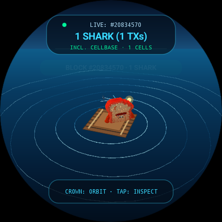 | 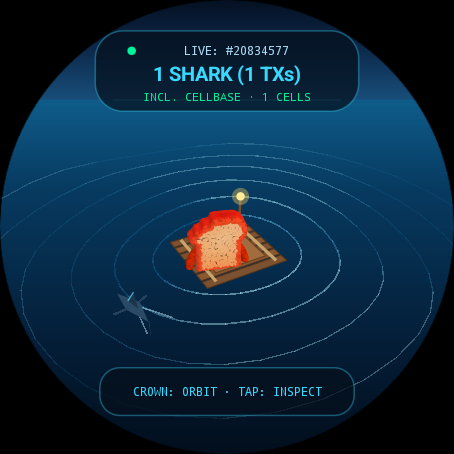 | 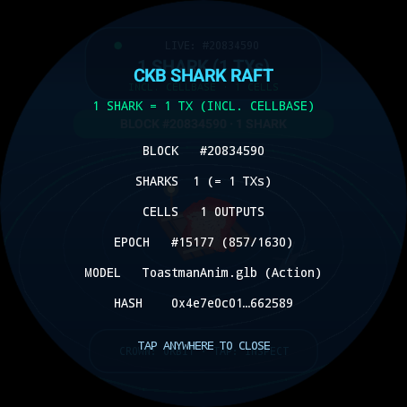 |

### 6. Exhibition: CKB Pirate Broadside (`BoatAnimated.glb`)
Presents the live Nervos CKB blockchain as an **ocean-going pirate ship firing cannon volleys across a Gerstner wave sea** (`1 New Block = 1 Cannon Volley`, `1 Transaction INCLUDING cellbase = 1 Cannon Shot`). Both the standalone Three.js exhibit (`pirate.html`) and the native Wear OS engine (`PirateShipVisualiserView.kt`) load the supplied `BoatAnimated.glb` 3D pirate ship (`40,651` vertices, `47,996` triangles, embedded `2.01 MB` texture) with wave-derived heave/pitch/roll (`BoatFloatRoot`), 8 broadside cannon emitters, muzzle flashes, drifting smoke, ballistic cannonballs colliding with the displaced wave surface, vertical splash plumes, expanding foam rings, persistent V-wake, and bow spray!

| Pirate Ship on Gerstner Sea | Broadside Cannon Volley & Splashes | Block Volley Inspector |
| :---: | :---: | :---: |
| 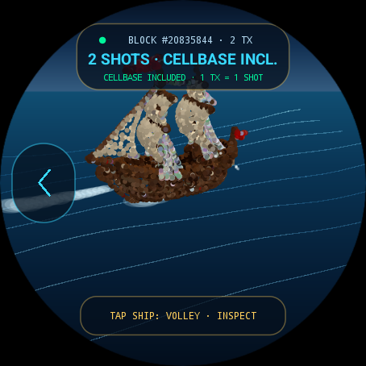 | 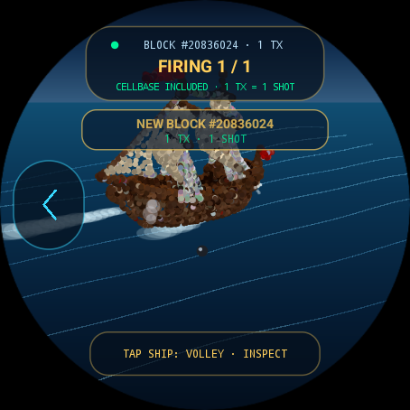 | 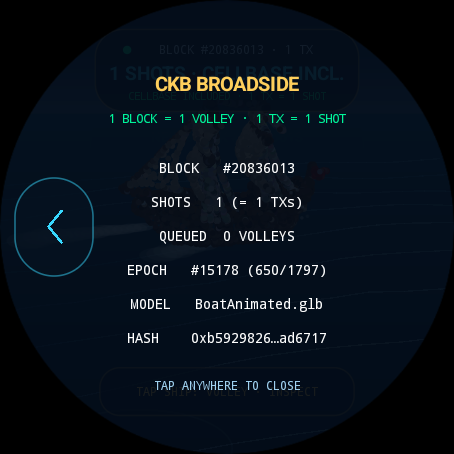 |

### 7. Exhibition: CKB Halving & Live Epoch Water Vessel
Visualizes the current variable-length **Nervos CKB Epoch** as a **3D borosilicate glass hydro-chronometer vessel filling with animated water** from a stationary bottom upward (`(epoch.index + 1) / epoch.length`), while continuously forecasting the **Next CKB Primary Issuance Halving (`8,760`-epoch interval)** using historical epoch pace sampling (`get_epoch_by_number` + `get_header_by_number` trimmed-mean duration with a 4-hour target fallback). Every new canonical block releases a condensation droplet from the top nozzle that splashes into the meniscus, triggers concentric wave ripples, and boosts rising micro-bubbles.

| Live Epoch Water Vessel | New-Block Droplet & Meniscus Ripple | Halving & Epoch Pace Inspector |
| :---: | :---: | :---: |
| 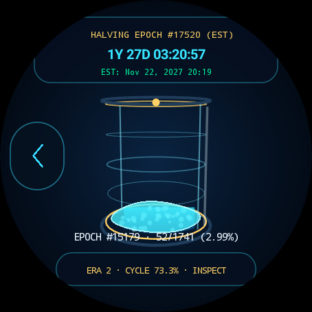 | 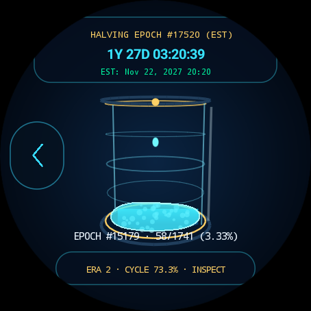 | 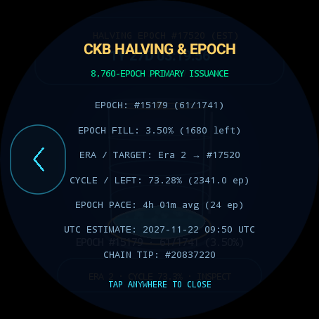 |

### 8. Exhibition: CKB Illuminated Ferris Wheel
Presents the live Nervos CKB blockchain as a **nighttime amusement-park illuminated Ferris wheel** (`Ferris wheel rotating = Nervos Network progressing`, `New CKB block = Ferris wheel arriving at the station`). Built with concentric front/back tubular rims, cross-bracing struts, 16 radial twin-spokes, 16 counter-rotating passenger gondolas with damped pendulum inertia, A-frame support legs, and a festive boarding station. When a new canonical block arrives, decorative rim and spoke bulbs smoothly morph across 6 curated nighttime palettes with a travelling radial/clockwise light wave, the wheel gracefully decelerates (`DECELERATING`) to a brief station hold (`STOPPED`) with a non-obscuring block arrival card (`#blockNumber`, total transaction count including cellbase, and block timestamp), and then smoothly accelerates back to operating speed (`ACCELERATING` $\rightarrow$ `RUNNING`).

| Nighttime Ferris Wheel (`RUNNING`) | New Block Station Arrival (`STOPPED`) | Block & Station Inspector |
| :---: | :---: | :---: |
| 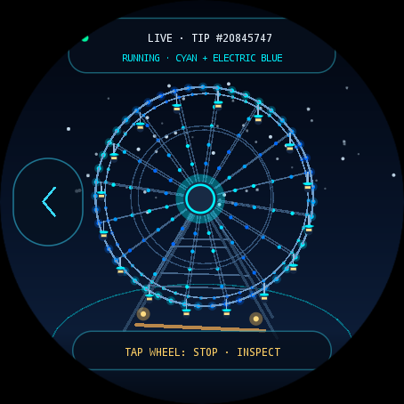 | 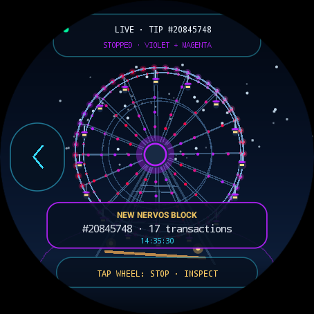 | 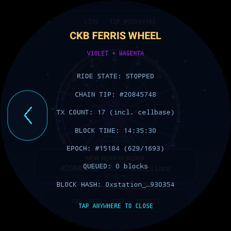 |

---

## 🌟 Core Architecture

### Dual-Engine Design
1. **Native Wear OS 60 FPS Canvas & GLB Engine** (`LabVisualiserView.kt`, `BonsaiVisualiserView.kt`, `CuckooVisualiserView.kt`, `LegoTowerVisualiserView.kt`, `SharkRaftVisualiserView.kt`, `PirateShipVisualiserView.kt`, `HalvingVesselVisualiserView.kt`, `FerrisWheelVisualiserView.kt`):
   - Standard Android `WebView` is omitted on Wear OS devices to conserve RAM and storage.
   - We engineered a zero-overhead, hardware-accelerated native 2D/3D renderer running at a locked 60 FPS on the Pixel Watch 3 GPU, including a native binary glTF 2.0 (`.glb`) parser and skeletal/surflet renderer for `ToastmanAnim.glb` and `BoatAnimated.glb`.
   - Direct coroutine-based JSON-RPC streaming over Wi-Fi/Bluetooth proxy with minimal battery consumption.
2. **Self-Contained Three.js Web Exhibits** (`index.html`, `bonsai.html`, `cuckoo.html`, `bricks.html`, `sharks.html`, `pirate.html`, `halving.html`, `ferris.html`):
   - Standalone single-file HTML/CSS/JavaScript implementations.
   - Procedural 3D geometry, `GLTFLoader` + `AnimationMixer` character and ship animation, custom GLSL Gerstner ocean and hydro-vessel meniscus shaders, `InstancedMesh` LEGO brick and Ferris wheel bulb rendering, refractive Fresnel glass materials, hinged mechanical clockwork, and Web Audio API sound synthesis.
   - Smooth museum-turntable auto-orbit with pinch-to-zoom and touch drag controls.

---

## 🧬 CKB Cell Model & Epoch Implementation

This visualizer suite strictly adheres to the fundamental architecture of Nervos CKB:

> **Every entry in every transaction's `outputs` array is one newly created CKB Cell.**

$$\text{newCellCount} = \sum_{\text{tx} \in \text{block.transactions}} \text{tx.outputs.length}$$

- **Comprehensive Scope**: Counts all transactions and transaction outputs, including the cellbase transaction.
- **Excluded Non-Outputs**: Ignores inputs, cellDeps, header deps, witnesses, and `outputs_data`.
- **Identity by OutPoint**: Cells are strictly identified by OutPoint (`${txHash}:${outputIndex}`).
- **Capacity Conversion**: Hex Shannons parsed using arbitrary-precision arithmetic:
  $$1\text{ CKB} = 100,000,000\text{ Shannons}$$
- **RFC-0027 Packed Epoch Decoding**:
  - `epochNumber = epochRaw & 0xFFFFFF` (bits 0..23)
  - `epochIndex = (epochRaw >> 24) & 0xFFFF` (bits 24..39)
  - `epochLength = (epochRaw >> 40) & 0xFFFF` (bits 40..55)
- **Primary Issuance Halving (`8,760` Epochs)**:
  - $\text{nextHalvingEpoch} = \left(\lfloor\text{currentEpoch} / 8760\rfloor + 1\right) \times 8760$
- **FIFO Block Event Queue**: Rapidly arriving blocks are queued and deduplicated by block hash so no block animation is ever dropped or overlapped.

---

## ⌚ Pixel Watch 3 Hardware Integrations

- **Digital Crown / Rotary Encoder**:
  - Physical watch crown inputs (`AXIS_SCROLL`) smoothly orbit the 3D camera around the centerpiece with realistic rotational inertia.
- **Haptic Engine (`VibratorManager`)**:
  - Subtle tactile ticks on rotary crown increments.
  - Rhythmic double-pulses upon new block commits, cannon volleys, and cuckoo calls.
  - Crisp haptic clicks when inspecting a Cell specimen, block plaque, or locking an Epoch brick.
- **In-Visualizer Back-to-Menu Navigation**:
  - Floating 9-o'clock `<` pill button and left-edge swipe-to-dismiss gesture return cleanly to the main visualizer menu without closing the app.
- **AMOLED Power Optimization**:
  - Pure `#000000` black backgrounds to minimize power draw on wearable OLED panels.
  - Capped pixel ratios and frame throttling when the screen is dimmed.
- **Keep Screen Awake (`FLAG_KEEP_SCREEN_ON`)**:
  - Configurable toggle so users can monitor the live blockchain without display timeout.

---

## 📁 Repository Structure

```text
watch-visualiser/
├── index.html                   # CKB Cell Laboratory (Three.js Web Exhibit)
├── bonsai.html                  # Japanese Maple Bonsai (Three.js Web Exhibit)
├── cuckoo.html                  # Mechanical Cuckoo Clock (Three.js Web Exhibit)
├── bricks.html                  # Epoch LEGO Brick Tower (Three.js Web Exhibit)
├── sharks.html                  # CKB Shark Raft (Three.js + GLTFLoader Web Exhibit)
├── pirate.html                  # CKB Pirate Broadside (Three.js + GLTFLoader Web Exhibit)
├── halving.html                 # CKB Halving & Live Epoch Water Vessel (Three.js Web Exhibit)
├── ferris.html                  # CKB Illuminated Ferris Wheel (Three.js Web Exhibit)
├── ToastmanAnim.glb             # Supplied 3D Toastman character with Action animation
├── BoatAnimated.glb             # Supplied 3D Pirate Ship with Action animation & texture
├── three.min.js                 # Bundled Three.js engine for offline execution
├── server.py                    # Zero-dependency local dev server with auto port detection
├── build.gradle.kts             # Root Gradle build script
├── settings.gradle.kts          # Gradle project configuration
├── gradle.properties            # JVM & AndroidX optimization properties
├── gradlew                      # Gradle wrapper script
├── screenshots/                 # Captured Pixel Watch 3 & emulator screenshots
└── app/
    ├── build.gradle.kts         # Wear OS application module (Compose for Wear OS)
    └── src/main/
        ├── AndroidManifest.xml  # Standalone watch app declaration & permissions
        ├── assets/visualisers/  # Bundled offline visualizer web apps & 3D GLB assets
        │   ├── ckb-cell-lab/index.html
        │   ├── ckb-bonsai/index.html
        │   ├── ckb-cuckoo/index.html
        │   ├── ckb-bricks/index.html
        │   ├── ckb-sharks/
        │   │   ├── index.html
        │   │   └── ToastmanAnim.glb
        │   ├── ckb-pirate/
        │   │   ├── index.html
        │   │   └── BoatAnimated.glb
        │   ├── ckb-halving/index.html
        │   └── ckb-ferris/index.html
        ├── java/network/nervos/watchvisualiser/
        │   ├── MainActivity.kt        # Rotary-scrollable Wear OS Compose menu
        │   ├── VisualiserActivity.kt  # Native visualizer activity dispatcher & back pill
        │   ├── SettingsActivity.kt    # CKB RPC & haptic settings screen
        │   ├── data/
        │   │   ├── CkbRpcClient.kt       # Native CKB JSON-RPC & Cell/Epoch extractor
        │   │   ├── VisualiserRegistry.kt # Extensible visualizer catalog
        │   │   └── AppPreferences.kt     # SharedPreferences store
        │   └── ui/
        │       ├── LabVisualiserView.kt           # 60 FPS Native Cell Lab renderer
        │       ├── BonsaiVisualiserView.kt        # 60 FPS Native Bonsai renderer
        │       ├── CuckooVisualiserView.kt        # 60 FPS Native Cuckoo Clock renderer
        │       ├── LegoTowerVisualiserView.kt     # 60 FPS Native Epoch Brick Tower renderer
        │       ├── SharkRaftVisualiserView.kt     # 60 FPS Native Shark Raft & GLB renderer
        │       ├── PirateShipVisualiserView.kt    # 60 FPS Native Pirate Broadside & GLB renderer
        │       ├── HalvingVesselVisualiserView.kt # 60 FPS Native Halving & Epoch Water Vessel
        │       └── FerrisWheelVisualiserView.kt   # 60 FPS Native Illuminated Ferris Wheel
        └── res/                       # Vector drawables, colors, strings
```

---

## 🚀 Getting Started

### 1. Instant Browser Preview
Run the included development server:
```bash
python3 server.py
```
Open in any browser:
- **CKB Cell Laboratory**: [http://localhost:8084/](http://localhost:8084/)
- **Japanese Maple Bonsai**: [http://localhost:8084/bonsai.html](http://localhost:8084/bonsai.html)
- **Mechanical Cuckoo Clock**: [http://localhost:8084/cuckoo.html](http://localhost:8084/cuckoo.html)
- **Epoch Brick Tower**: [http://localhost:8084/bricks.html](http://localhost:8084/bricks.html)
- **CKB Shark Raft (`ToastmanAnim.glb`)**: [http://localhost:8084/sharks.html](http://localhost:8084/sharks.html)
- **CKB Pirate Broadside (`BoatAnimated.glb`)**: [http://localhost:8084/pirate.html](http://localhost:8084/pirate.html)
- **CKB Halving & Epoch Water Vessel**: [http://localhost:8084/halving.html](http://localhost:8084/halving.html)
- **CKB Illuminated Ferris Wheel**: [http://localhost:8084/ferris.html](http://localhost:8084/ferris.html)

*Tip: Click the gear icon $\rightarrow$ **"TEST BLOCK"**, **"DEMO CUCKOO"**, **"DEMO NEW BLOCK"**, or **"SIMULATE"** to trigger an immediate CKB block event.*

---

### 2. Deploy to Physical Pixel Watch 3

#### Option A: Direct Download (No build required!)
1. Download [`ckb-watch-visualiser-v1.0.0.apk`](https://github.com/toastmanAu/ckb-watch-visualiser/releases/download/v1.0.0/ckb-watch-visualiser-v1.0.0.apk) from the [v1.0.0 Release](https://github.com/toastmanAu/ckb-watch-visualiser/releases/tag/v1.0.0).
2. Install via phone or PC:
   - **From Android Phone**: Open **Wear Installer 2** or **Bugjaeger**, connect via Wireless Debugging, and push the APK.
   - **From Computer**:
     ```bash
     adb connect <WATCH_IP>:<PORT>
     adb install -r ckb-watch-visualiser-v1.0.0.apk
     ```

#### Option B: Build from Source
1. Enable **Developer Options** and **Wireless/USB Debugging** on your Pixel Watch 3.
2. Connect via ADB:
   ```bash
   adb connect <WATCH_IP>:<PORT>
   # or connect via USB charging cradle
   adb devices
   ```
3. Build and install:
   ```bash
   ./gradlew assembleDebug
   adb install -r app/build/outputs/apk/debug/app-debug.apk
   ```
4. Press the physical **Crown button** on the watch, open **CKB Visualisers**, and select any active visualizer!

---

### 3. Run in the Wear OS Emulator
To spin up a local Pixel Watch 3 emulator:
```bash
# Create Wear OS AVD (if not already created)
echo "no" | avdmanager create avd -n Pixel_Watch_3_WearOS \
  -k "system-images;android-34;android-wear;x86_64" \
  -d "wearos_large_round" --force

# Launch emulator headless
emulator -avd Pixel_Watch_3_WearOS -no-window -no-audio -gpu swiftshader_indirect &

# Install & Launch
adb -s emulator-5556 install -r app/build/outputs/apk/debug/app-debug.apk
adb -s emulator-5556 shell am start -n network.nervos.watchvisualiser/.MainActivity
```

---

## 🗺️ Roadmap & Visualizers

The [`VisualiserRegistry.kt`](app/src/main/java/network/nervos/watchvisualiser/data/VisualiserRegistry.kt) hosts multiple Nervos visualizers:

- [x] **CKB Cell Laboratory** (FLAGSHIP) — Microscopic UTXO organisms swirling into the Liquid of Knowledge.
- [x] **Japanese Maple Bonsai** (ACTIVE) — Newly created Cells falling as vibrant autumn leaves.
- [x] **Mechanical Cuckoo Clock** (ACTIVE) — Black Forest chalet clock that chimes & reveals decoded Epoch state on every canonical block.
- [x] **Epoch Brick Tower** (ACTIVE) — Live CKB Epoch constructed block-by-block from interlocking 3D LEGO-style bricks.
- [x] **Shark Raft (`ToastmanAnim.glb`)** (ACTIVE) — Animated 3D Toastman riding a wooden ocean raft circled by 1 shark per CKB transaction (including cellbase).
- [x] **Pirate Broadside (`BoatAnimated.glb`)** (ACTIVE) — Ocean-going pirate ship firing 1 cannon shot per CKB transaction (including cellbase) across a Gerstner sea.
- [x] **Halving & Epoch Water Vessel** (ACTIVE) — Borosilicate glass hydro-chronometer filling with water across the live CKB Epoch & forecasting the `8,760`-epoch Primary Issuance Halving.
- [x] **Illuminated Ferris Wheel** (ACTIVE) — Nighttime amusement-park Ferris wheel that changes bulb palettes & pauses at the boarding station for every new CKB block.
- [ ] **Fiber Network Star Map** (COMING SOON) — Real-time P2P lightning payment channel routing.
- [ ] **Mempool Particle Collider** (COMING SOON) — High-energy unconfirmed transaction collisions.

---

## 📜 License
Licensed under the [MIT License](LICENSE).
