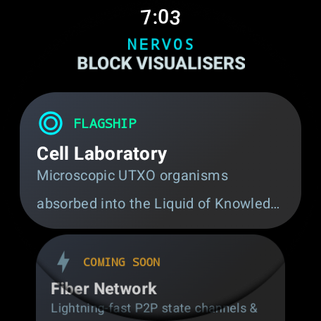
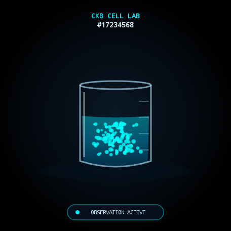
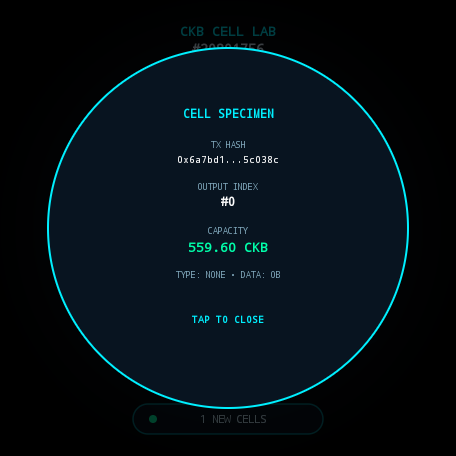
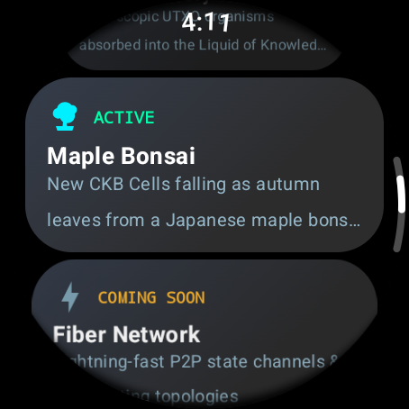
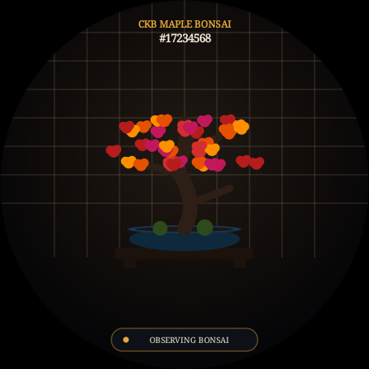
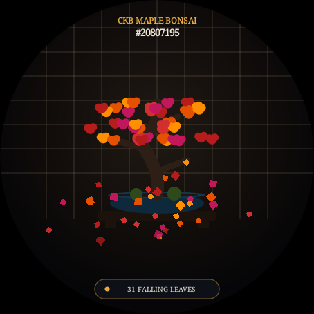

# ⌚ Nervos CKB Wear OS Visualisers (Pixel Watch 3)

[](https://wearos.google.com/)
[](https://www.nervos.org/)
[](https://threejs.org/)
[](https://developer.android.com/training/wearables/compose)

An interactive, high-performance **Wear OS (Pixel Watch 3)** housing and launcher for live **Nervos Network (CKB)** blockchain visualizers.

This project bridges live on-chain UTXO state transitions into tactile, scientific, and contemplative exhibits on your wrist, complete with physical digital crown navigation, haptic engine feedback, and standalone Three.js mobile-first web exhibits.

---

## 📸 Visual Showcase

### 1. Flagship: CKB Cell Laboratory
Microscopic biological UTXO organisms materialize from real on-chain data and swirl into a central glass beaker containing the glowing **"Liquid of Knowledge"**.

| Watch Menu | Observation Mode | Specimen Inspection Card |
| :---: | :---: | :---: |
|  |  |  |

### 2. Exhibition: Japanese Maple Bonsai
Newly created CKB Cells detach as vibrant autumn maple leaves that gracefully flutter, tumble, and drift from a lush **Japanese Maple Bonsai** canopy onto an ornate display stand.

| Launcher Selection | Japanese Maple Bonsai | Falling Autumn Leaves |
| :---: | :---: | :---: |
|  |  |  |

---

## 🌟 Core Architecture

### Dual-Engine Design
1. **Native Wear OS 60 FPS Canvas Engine** (`LabVisualiserView.kt`, `BonsaiVisualiserView.kt`):
   - Standard Android `WebView` is omitted on Wear OS devices to conserve RAM and storage.
   - We engineered a zero-overhead, hardware-accelerated native 2D/3D renderer running at a locked 60 FPS on the Pixel Watch 3 GPU.
   - Direct coroutine-based JSON-RPC streaming over Wi-Fi/Bluetooth proxy with minimal battery consumption.
2. **Self-Contained Three.js Web Exhibits** (`index.html`, `bonsai.html`):
   - Standalone single-file HTML/CSS/JavaScript implementations.
   - Procedural 3D geometry, refractive Fresnel glass materials, particle vortices, and Web Audio API sound synthesis.
   - Smooth museum-turntable auto-orbit with pinch-to-zoom and touch drag controls.

---

## 🧬 CKB Cell Model Implementation

This visualizer strictly adheres to the fundamental architecture of Nervos CKB:

> **Every entry in every transaction's `outputs` array is one newly created CKB Cell.**

$$\text{newCellCount} = \sum_{\text{tx} \in \text{block.transactions}} \text{tx.outputs.length}$$

- **Comprehensive Scope**: Counts all transaction outputs, including the cellbase transaction.
- **Excluded Non-Outputs**: Ignores inputs, cellDeps, header deps, witnesses, and `outputs_data`.
- **Identity by OutPoint**: Cells are strictly identified by OutPoint (`${txHash}:${outputIndex}`).
- **Capacity Conversion**: Hex Shannons parsed using arbitrary-precision arithmetic:
  $$1\text{ CKB} = 100,000,000\text{ Shannons}$$
- **Deterministic Trait Generation**:
  - Capacity scales organism volume or leaf mass logarithmically.
  - Presence of a Type Script generates a distinctive glowing organelle ring or golden hue.
  - Data payload ($>0\text{ bytes}$) generates visible internal granules.

---

## ⌚ Pixel Watch 3 Hardware Integrations

- **Digital Crown / Rotary Encoder**:
  - Physical watch crown inputs (`AXIS_SCROLL`) smoothly orbit the 3D camera around the centerpiece with realistic rotational inertia.
- **Haptic Engine (`VibratorManager`)**:
  - Subtle tactile ticks on rotary crown increments.
  - Rhythmic double-pulses upon new block commits.
  - Crisp haptic clicks when inspecting a Cell specimen.
- **AMOLED Power Optimization**:
  - Pure `#000000` black backgrounds to minimize power draw on wearable OLED panels.
  - Capped pixel ratios and frame throttling when the screen is dimmed.
- **Keep Screen Awake (`FLAG_KEEP_SCREEN_ON`)**:
  - Configurable toggle so users can monitor the live blockchain without display timeout.

---

## 📁 Repository Structure

```text
watch-visualiser/
├── index.html                   # CKB Cell Laboratory (Three.js Web Exhibit)
├── bonsai.html                  # Japanese Maple Bonsai (Three.js Web Exhibit)
├── three.min.js                 # Bundled Three.js engine for offline execution
├── server.py                    # Zero-dependency local dev server with auto port detection
├── build.gradle.kts             # Root Gradle build script
├── settings.gradle.kts          # Gradle project configuration
├── gradle.properties            # JVM & AndroidX optimization properties
├── gradlew                      # Gradle wrapper script
├── screenshots/                 # Captured Pixel Watch 3 & emulator screenshots
└── app/
    ├── build.gradle.kts         # Wear OS application module (Compose for Wear OS)
    └── src/main/
        ├── AndroidManifest.xml  # Standalone watch app declaration & permissions
        ├── assets/visualisers/  # Bundled offline visualizer web apps
        │   ├── ckb-cell-lab/index.html
        │   └── ckb-bonsai/index.html
        ├── java/network/nervos/watchvisualiser/
        │   ├── MainActivity.kt        # Rotary-scrollable Wear OS Compose menu
        │   ├── VisualiserActivity.kt  # Native visualizer activity dispatcher
        │   ├── SettingsActivity.kt    # CKB RPC & haptic settings screen
        │   ├── data/
        │   │   ├── CkbRpcClient.kt       # Native CKB JSON-RPC & Cell extractor
        │   │   ├── VisualiserRegistry.kt # Extensible visualizer catalog
        │   │   └── AppPreferences.kt     # SharedPreferences store
        │   └── ui/
        │       ├── LabVisualiserView.kt    # 60 FPS Native Cell Lab renderer
        │       └── BonsaiVisualiserView.kt # 60 FPS Native Bonsai renderer
        └── res/                       # Vector drawables, colors, strings
```

---

## 🚀 Getting Started

### 1. Instant Browser Preview
Run the included development server:
```bash
python3 server.py
```
Open in any browser:
- **CKB Cell Laboratory**: [http://localhost:8084/](http://localhost:8084/)
- **Japanese Maple Bonsai**: [http://localhost:8084/bonsai.html](http://localhost:8084/bonsai.html)

*Tip: Click the gear icon $\rightarrow$ **"TEST BLOCK"** to simulate an immediate CKB block event with authentic UTXO organisms or falling leaves.*

---

### 2. Deploy to Physical Pixel Watch 3
1. Enable **Developer Options** and **Wireless/USB Debugging** on your Pixel Watch 3.
2. Connect via ADB:
   ```bash
   adb connect <WATCH_IP>:<PORT>
   # or connect via USB charging cradle
   adb devices
   ```
3. Build and install the debug APK:
   ```bash
   ./gradlew assembleDebug
   adb install -r app/build/outputs/apk/debug/app-debug.apk
   ```
4. Press the physical **Crown button** on the watch, open **CKB Visualisers**, and select any active visualizer!

---

### 3. Run in the Wear OS Emulator
To spin up a local Pixel Watch 3 emulator:
```bash
# Create Wear OS AVD (if not already created)
echo "no" | avdmanager create avd -n Pixel_Watch_3_WearOS \
  -k "system-images;android-34;android-wear;x86_64" \
  -d "wearos_large_round" --force

# Launch emulator headless
emulator -avd Pixel_Watch_3_WearOS -no-window -no-audio -gpu swiftshader_indirect &

# Install & Launch
adb -s emulator-5556 install -r app/build/outputs/apk/debug/app-debug.apk
adb -s emulator-5556 shell am start -n network.nervos.watchvisualiser/.MainActivity
```

---

## 🗺️ Roadmap & Upcoming Visualizers

The [`VisualiserRegistry.kt`](app/src/main/java/network/nervos/watchvisualiser/data/VisualiserRegistry.kt) is designed to host multiple Nervos visualizers:

- [x] **CKB Cell Laboratory** (FLAGSHIP) — Microscopic UTXO organisms swirling into the Liquid of Knowledge.
- [x] **Japanese Maple Bonsai** (ACTIVE) — Newly created Cells falling as vibrant autumn leaves.
- [ ] **Fiber Network Star Map** (COMING SOON) — Real-time P2P lightning payment channel routing.
- [ ] **Mempool Particle Collider** (COMING SOON) — High-energy unconfirmed transaction collisions.
- [ ] **Epoch Celestial Clock** (COMING SOON) — Halving cycles, difficulty adjustments, and DAO yields.

---

## 📜 License
Licensed under the [MIT License](LICENSE).
